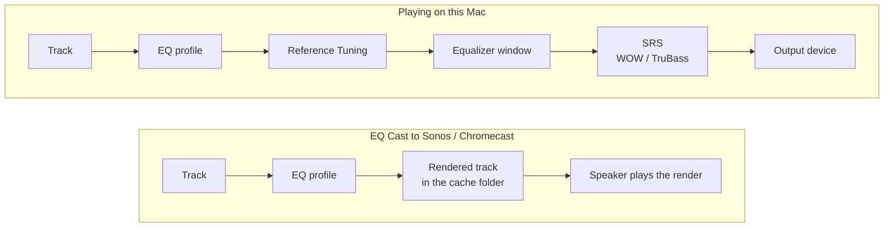

  <h1 align="center">NullPlayer. Your media. Your backend. Your home devices. Your UI.</h2>


https://github.com/user-attachments/assets/4f53dbd9-cfd2-4ca1-87d5-96d39e224a92

https://github.com/user-attachments/assets/46c1192c-cc57-4531-89b2-dbbb5e253a63


  <p align="center">
      
    
  </p>


## **If you enjoy NullPlayer please ⭐ STAR ⭐ the project on GitHub**

## Features

NullPlayer is 100% open source and built as a clean-room effort; no Winamp, WACUP, or Windows Media Player source code has been copied or viewed

Nullplayer is the **first macOS and only open-source engine capable of rendering Winamp ClassicPro and Winamp 5 (`.wal`) skins**, letting you run all Winamp skin types on macOS while enjoying modern media ecosystem support

NullPlayer is also the **first macOS and only open-source engine capable of rendering Windows Media Player (`.wmz`) skins**:from WMP 7, 7.1, XP (8), 9, 10, 11 and 12. It supports their views, JScript, EQ, SRS and visualizer controls, all driving NullPlayer's playback engine. Skin scripts run sandboxed in an isolated JavaScriptCore context with no ActiveX, registry, shell, DLL, plug-in or HTML access.

NullPlayer is not affiliated with, endorsed by, or connected to Winamp, Nullsoft, Microsoft, Winamp Group SA, Llama Group, Radionomy Group, Jamendo, Hotmix, Bridger, SHOUTcast, Sonos, Plex, WACUP, Emby, Jellyfin, Google, Panic or anyone else

No Winamp, Windows Media Player or Sonique skins or Audion faces are distributed with the project, apart from the default `.wal` skin, [iTunes Miniplayer](https://github.com/spacecowgoesmoo/Old-iTunes-Miniplayer), shipped with its author's permission

### General Features

- Library browser for Plex, Jellyfin, Emby, Navidrome/Subsonic, YouTube and local files, with List, Cover Flow and Tiles views
- 21-band EQ (Original/Original-Metal) and 10-band EQ (Classic, Modern)
- [EQ profiles](#quick-start-eq-profiles) — saved 31-band EQ curves with separate left and right channels and a parametric stage, assigned to tracks, albums or artists and applied whenever they play
- [EQ Cast](#quick-start-eq-cast) — casts to Sonos and Chromecast with the track's EQ profile applied, by rendering the track with its profile first
- Gapless + Sweet Fades (configurable crossfade), volume normalization, play speed (0.25×–4×), and Reference Tuning (432/440 Hz/custom)
- SRS inspired audio enhancements: WOW stereo widening and TruBass low-frequency enhancement plus a Headphones profile for TruBass
- Stream Ripper — rip and import stream URLs to FLAC, MP3, or MP4 with metadata, cover art, and `.cue` sheets (requires `yt-dlp` + `ffmpeg`)
- Intelligent radio mix generation for all sources
- Cast to Sonos (multi-room), Chromecast, DLNA, and AirPlay — local files, server streams, and radio
- Sonos content filtering for unsupported lossless formats and improved playlist support
- Sonos Rooms window for picking cast rooms and setting each room's volume individually
- Drag-and-drop, macOS Now Playing integration, and [Discord Music Presence](https://github.com/ungive/discord-music-presence)
- Headless CLI for querying libraries, playback, and routing to local outputs or cast devices, full color terminal cover art rendering

### Backend Support

- Server integration for Plex, Jellyfin, Emby, YouTube and Navidrome/Subsonic with scrobbling
- Local media library with metadata parsing, editing, and management
- Mixed playlists — combine tracks or video from any sources (local, Plex, Jellyfin, Emby, Subsonic/Navidrome, radio, movies, YouTube) into a single playlist
- Internet radio (Shoutcast/Icecast) with live metadata and auto-reconnect
- YouTube as a library source — search and subscribe to channels, browse uploads, download audio (FLAC/ALAC/MP3/AAC/Opus) or video up to 4K ad-free (requires `yt-dlp` + `ffmpeg`)

### Skin System Support

- Classic mode: full `.wsz` Winamp 2.X skin support with window snapping and docking
- Winamp Modern (`.wal`) skin support (Winamp 5.X and ClassicPro); the ClassicPro Windows plug-in engine is extracted from the user-supplied installer and runs natively on macOS
- Original mode: JSON-based skin system with color theming, custom assets, procedural backgrounds, and bloom effects and full skinning documentation for authors
- Original-Metal mode: seven brushed-metal finishes with backlit LCD displays
- Windows Media Player mode: the only Mac player that runs WMP 7–12 `.wmz` skins, loaded through a bounded, isolated engine with a sandboxed JScript runtime; import, select, remove, and switch views from **Skins > Media Player**, or fall back to a built-in unskinned player
- Panic Audion faces: the 2021 face archive, drawn by a port of Panic's own FaceKit viewer and checked against it face by face; every face button drives NullPlayer, and its windows take their colours from the face. Install and select from **Skins > Audion Faces**
- Sonique 1.x `.sgf` skins: all three modes (navigator, mid and small) drawn from the skin, with the navigator's visual mode screen and equalizer drawer; checked against real Sonique 1.96 skin by skin. Install and select from **Skins > Sonique**
- Live skin switching. Cycle through Classic, Modern, Original, Original-Metal, Windows Media Player skins, Audion faces and Sonique skins with no restart or interuption in playback
- Full development harness for debugging and reverse engineering Winamp 5, ClassicPro, and Windows Media Player skins, and for checking Audion faces against Panic's FaceKit, and Sonique skins against real Sonique
- Native nullplayer windows are themed to the host skin

### Media Support

- Audio codecs: MP3, FLAC, AAC, WAV, AIFF, ALAC, OGG
- Video codecs: MKV, MP4, MOV, AVI, WebM, HEVC (VLCKit/libVLC)
- `.cue` sheet support - virtual split cue/flac into ephemeral playlist items or optionally split to multiple tagged files on import

### Unique Nullplayer Windows

- Visualizations -  ProjectM (100 presets included), Geiss and Tripex ports, Art window with album art effects, and spectrum analyzer
- Audio Analysis window — oscilloscope, stereo peak/RMS meters, scrolling Metal spectrogram
- Cava spectrum analyzer — bar spectrum with mono/stereo modes, gradient presets, and configurable smoothing
- PeppyMeter — skinnable analog VU meter with 25 templates and auto-switch mode
- Flow network monitor — live throughput graph with selectable interface
- Equalizer Studio — editor for EQ profiles: 31 faders and a 4-band parametric strip per channel, a spectrum analyser per channel, live preview ([quick start](#quick-start-eq-profiles))
- Sonos Rooms — resizable room mixer with a checkbox and independent volume slider per room (usable before and during a cast)
- Compact Mode — menu-bar-only app with embedded mini player (Classic, Original, and Original-Metal)

### Visualization Support

NullPlayer's visualizations span its windows, from the in-skin main-window display to full-screen engines. All visualization choices persist across launches.:

- **Main Window** — 12 inline modes on the player's own display: Off, Classic 19-band, Cava bar, Enhanced, Ultra, Fire, JWST (deep-space), Lightning, Matrix, Snow, EKG, and the vis_classic analyzer port; cycle with a double-click or pick from **Visuals > Main Window > Mode**
- **Spectrum Window** — dedicated 84-bar analyzer with 9 modes (Winamp/vis_classic/Enhanced/Ultra/Fire/JWST/Lightning/Matrix/Snow) and skin-matched styles
- **Cava** — a cava-style bar spectrum (clean-room vDSP port) in its own window and inline in the main window, with mono/stereo modes, gradient color presets, and configurable bars, smoothing, and bass tilt
- **ProjectM/MilkDrop** — 100+ bundled presets with OpenGL rendering and fullscreen support
- **Geiss** — port of Ryan Geiss's classic visualization with runtime controls (sensitivity, gamma, beat detection, palettes, auto-switch)
- **Tripex** — Winamp-era 3D visualization port
- **Album Art Visualizer** — 30 audio-reactive effects (Core Image) transforming album art in the Art window
- **Winamp Modern (`.wal`) skins** — the skin draws its own in-skin visualizations, including workscope/oscilloscope analyzers and custom engine visuals (e.g. the MMD3 and ClassicPro beat visualizers) 
- **Windows Media Player (`.wmz`) skins** — a skin's `<EFFECTS>` area renders native Spikes, Bars, Ambience, Cava, or vis_classic visuals inside the rectangle the skin draws for them
- **Audio Analysis** — Friture-style multi-pane window: Scope, Levels (peak/RMS), Spectrogram, Octave, Pitch, and Delay
- **PeppyMeter** — skinnable analog VU meter (needle/bar) with 25 templates and a random auto-switch mode
- **Flow** — live network throughput graph with selectable interface

### Agentic Development Support

  NullPlayer is built to be worked on by coding agents as well as people. The repo ships the
  context an agent needs instead of making it rediscover the codebase every session.

 - **Subsystem skills** in [`skills/`](skills/) — maintained technical documentation, one owner per subsystem: audio and EQ, each skin engine, every media-server integration, casting, each visualizer, the local library, CLI, and testing. The clean-room skin engines add per-skin dossiers (what each problem skin taught the engine and what was ruled out), a canonical probe/harness reference, and a `skin-subsystem-blueprint` for adding a new skin family.
 - **Invocable skills, not just docs** — `/wal-skin-report <skin.wal>` produces a full compatibility report for a Winamp 5 skin; `skin-screenshots` drives the live app to capture one main-window frame per skin across every skin system and assembles a slideshow GIF.
 - **Automation-first surfaces** — a headless `--cli` mode for querying libraries, resolving sources, starting playback, and routing to Sonos / Chromecast / DLNA, plus a `--ui-testing`launch mode and accessibility identifiers so the UI can be driven programmatically.
 - **Scripted workflows** — one-command bootstrap, build-and-run, DMG/MAS packaging, third-partynotice generation and validation, `.wal` and `.wmz` corpus render sweeps and census (with a corpus exclusion list and baseline diffing), and backlog validation, so an agent verifies its work the same way a maintainer does.
 - **Live-defect workflow** — a `live-ui-testing` process skill for bugs that only show on screen: instrument first, drive the running app with AppleScript and synthesized input, and measure what is actually drawn; every subsystem skill routes its *Debugging a live defect* section there.
 - **Unit tests** under [`Tests/`](Tests/), with a documented testing philosophy (`skills/testing`) that explicitly forbids weakening tests changing app code just to make them pass.
 - **Explicit architectural guardrails** encoded where an agent will read them: skin engines must not cross-import, Winamp Modern (`.wal`) and Windows Media Player (`.wmz`) work must never alter Classic or Original behavior, the sprite-origin and `Data`-slicing gotchas are stated up front.
 - **App control: agents drive the real app** — the [`app-control`](skills/app-control/SKILL.md) skill lets an agent launch, configure, drive, screenshot, and measure the running debug build across every skin family (Classic, Original, Original-Metal, `.wal`, `.wmz`, Audion faces, Sonique `.sgf`):
- **Token friendly agent routing** A routing table picks the cheapest way to answer a question, from a headless probe to handing the user a preloaded interactive session. Canonical test media and launch recipes included.
  
## Installation

Download the latest DMG:

https://github.com/ad-repo/nullplayer/releases/latest/download/NullPlayer.dmg

Requires macOS 14 Sonoma or newer.

NullPlayer is signed with an Apple Developer ID and notarized by Apple, so it passes Gatekeeper's developer and notarization checks. macOS may still ask you to confirm the first launch.

1. Open `NullPlayer.dmg`.
2. Drag `NullPlayer.app` to Applications.
3. Open NullPlayer from Applications.

See [docs/download.md](docs/download.md) for the same install steps in a short download-only page.

### Install with Homebrew

[Homebrew](https://brew.sh/) is a free package manager for macOS. Installing with it makes updates a single command.

**New to Homebrew? Here's the whole thing, start to finish:**

1. Open **Terminal** — press `Cmd + Space`, type `Terminal`, and press Return.
2. Install Homebrew by pasting this line and pressing Return. It asks for your Mac login password (the cursor stays still while you type — that's normal) and takes a few minutes:

   ```bash
   /bin/bash -c "$(curl -fsSL https://raw.githubusercontent.com/Homebrew/install/HEAD/install.sh)"
   ```

   Already have Homebrew? Skip this step.
3. Add Homebrew to your shell so the `brew` command is found. The installer finishes by printing a **Next steps** section — run the two commands it lists. On Apple Silicon Macs (M1/M2/M3/M4) they are:

   ```bash
   echo 'eval "$(/opt/homebrew/bin/brew shellenv)"' >> ~/.zprofile
   eval "$(/opt/homebrew/bin/brew shellenv)"
   ```

   On older Intel Macs, replace `/opt/homebrew` with `/usr/local`. If `brew` already worked before you started, skip this step.
4. Add the NullPlayer tap (one-time configuration):

   ```bash
   brew tap ad-repo/nullplayer
   ```
5. Install NullPlayer:

   ```bash
   brew install --cask ad-repo/nullplayer/nullplayer
   ```
6. Open NullPlayer from your Applications folder or Launchpad.

**Updating to a new release:**

```bash
brew update
brew upgrade --cask ad-repo/nullplayer/nullplayer
```

<details>
<summary>Homebrew power-user notes</summary>

Verify the tap is serving the latest version:

```bash
brew livecheck --cask ad-repo/nullplayer/nullplayer
```

`brew uninstall --cask --zap nullplayer` removes app data under `~/Library/Application Support/NullPlayer` and the app's preferences/caches, but **does not** remove Keychain entries for Plex/Subsonic/Jellyfin/Emby tokens. To clear those:

```bash
security delete-generic-password -s com.nullplayer.app
```

</details>

### Optional command-line launcher

If you want to use NullPlayer as a scriptable command in terminal workflows or automation pipelines, the DMG includes:

- `nullplayer` — launcher wrapper
- `Install NullPlayer CLI.command` — one-click installer for `/usr/local/bin/nullplayer`

Install flow:

```bash
bash "/Volumes/NullPlayer/Install NullPlayer CLI.command"
nullplayer --cli --help
```

The launcher looks for:

- `/Applications/NullPlayer.app`
- `~/Applications/NullPlayer.app`

## Requirements

- macOS 14.0 (Sonoma) or later

### Optional command-line tools

The **YouTube source** and **Stream Ripper** features download and transcode media by shelling out to two command-line tools that are **not bundled** — install them via [Homebrew](https://brew.sh):

```bash
brew install yt-dlp ffmpeg
```

- **yt-dlp** — lists channel uploads and downloads audio/video. Required for any YouTube or Stream Ripper download.
- **ffmpeg** — merges YouTube's separate video + audio streams into an MP4 and transcodes audio to FLAC/MP3. Without it, video downloads fail with `Postprocessing: ffmpeg not found` and audio downloads can't be converted.

NullPlayer looks for both in the standard Homebrew/MacPorts locations (`/opt/homebrew/bin`, `/usr/local/bin`, `/opt/local/bin`, `/usr/bin`). Keep them current with `brew upgrade yt-dlp ffmpeg` — an outdated `yt-dlp` may fail to list or download videos as YouTube changes.

## Building from Source

Requires Xcode 15.0+ with Command Line Tools and Swift 5.9+.

```bash
# Clone the repository
git clone https://github.com/ad-repo/nullplayer.git
cd nullplayer

# Download required frameworks
./scripts/bootstrap.sh

# Build and run
./scripts/kill_build_run.sh
```

The bootstrap script downloads VLCKit and libprojectM from GitHub Releases with checksum verification.

To open in Xcode:

```bash
open Package.swift
```

## Dependencies

| Library | Purpose |
|---------|---------|
| [ZIPFoundation](https://github.com/weichsel/ZIPFoundation) | .wsz / .wmz skin and Audion face `.zip` extraction |
| [SQLite.swift](https://github.com/stephencelis/SQLite.swift) | Media library storage |
| [AudioStreaming](https://github.com/dimitris-c/AudioStreaming) | HTTP audio streaming for Plex |
| [FlyingFox](https://github.com/swhitty/FlyingFox) | Embedded HTTP server for local file casting |
| [libprojectM](https://github.com/projectM-visualizer/projectm) | ProjectM visualizations |

## EQ Profiles and EQ Cast

### How it works

The Equalizer window applies one curve to everything you play. An **EQ profile** is a separate,
named curve that belongs to specific music: you assign it to a track, album or artist, and it is
applied whenever that music plays.

- A profile is a 31-band curve (ISO ⅓-octave, 20 Hz–20 kHz) plus a 4-band parametric stage
  (high-pass filter, LF, LMF, HMF, HF) and a preamp, with the left and right channels set
  separately.
- Profiles are made and edited in **Windows ▸ Equalizer Studio**.
- When a track plays, its own profile is used; if it has none, its album's; if the album has
  none, its artist's.
- A profile runs before the Equalizer window. The two are independent: neither changes the other.
- Profiles apply to local files, media-server tracks, radio stations and downloaded YouTube audio.
  They do not apply to video.

**Casting.** Sonos and Chromecast fetch and decode the file themselves, so audio processing done in
NullPlayer never reaches them. The Sonos app's own EQ is limited to bass, treble and loudness.
**EQ Cast** applies the profile before casting: it renders the track with its profile into a new
file and casts that file instead of the original.

### Quick start: EQ profiles

Signal chain, playing locally and with EQ Cast:



The Studio's analyser shows the signal after the profile for local files, and the final output for
streams.

1. Play a track and open **Windows ▸ Equalizer Studio**. Your edits are heard on the playing
   track while the Studio is open.
2. Shape the curve. **GRAPHIC** shows the 31 faders; **PARAMETRIC** shows the high-pass filter and
   four bands with frequency, gain and Q dials. Both edit the same curve. With **LINK** lit, both
   channels move together; turn it off to set left and right separately. **BYPASS** plays a channel
   without the curve so you can compare.
3. Press **HEADROOM**. It lowers the preamp so the curve's highest boost peaks at 0 dB and does not
   clip.
4. Press **SAVE AS** and name the profile. Saving does not assign it. Once the Studio closes, a
   profile is heard only on music it is assigned to.
5. Right-click a track, album or artist in the Library, or a row in the queue, and choose
   **Assign EQ Profile ▸** *your profile*.
6. Queue rows playing with a profile show **∿** before the title, and **File Info** shows the
   profile and the level it came from, e.g. `EQ Profile: Warm (album)`.

To change a profile later, play something it is assigned to and open the Studio: it opens on the
playing track's profile. Edit it and press **SAVE**.

**Assigning:**

- **Inherit** removes the setting at that level, so the next level down applies. **Off** plays the
  item with no profile even if its album or artist has one.
- Assigning to a playlist or folder assigns to the tracks in it at that moment; tracks added later
  get nothing.
- An assignment matches the file path, tag or server ID it was made on. Moving or renaming a file,
  or retagging its album or artist, stops it matching.
- **Playback ▸ EQ Profiles** turns all profiles off without removing any assignments.

### Quick start: EQ Cast

1. Assign profiles to what you want to cast (above).
2. Turn on **Output ▸ EQ Cast ▸ Enabled** and choose a folder for the rendered files. Don't
   choose a folder your library watches, or the renders will be imported as duplicate tracks.
3. Start a cast to Sonos or Chromecast from the Output menu as usual.
4. The first track starts once it is rendered; a progress bar at the top of the main window shows
   how far along it is. Server tracks are downloaded first. The next three tracks are rendered in
   the background while you listen.

**What to know:**

- Only the profile is rendered. The Equalizer window and other effects (SRS, Reference Tuning,
  playback speed) are not applied.
- Supported: local files and Plex, Jellyfin, Emby and Navidrome/Subsonic tracks. Cast as the
  original file: radio, tracks from a cue sheet, video, sources with more than two channels, and tracks with
  no profile or set to **Off**.
- A render is reused while the assigned profile and its curve are unchanged. Editing a profile re-renders the tracks
  coming up next.
- Renders are 16-bit. A curve with large boosts can clip; press **HEADROOM** in the Studio and
  save.
- The folder is not cleared automatically, and every render is a full copy of the track.
  **Output ▸ EQ Cast** shows the cache size; **Delete Cache…** removes every render except the one
  being cast.

## Media Library

Library data is stored as a SQLite database at `~/Library/Application Support/NullPlayer/library.db`.

**Backup & Restore API** (`MediaLibrary.swift`):

| Function | Description |
|----------|-------------|
| `backupLibrary(customName:)` | Creates timestamped `.db` backup, returns URL |
| `restoreLibrary(from:)` | Restores from backup (auto-backs up current first) |
| `listBackups()` | Returns backup URLs sorted newest first |
| `deleteBackup(at:)` | Deletes a backup file |

Backups are stored in `~/Library/Application Support/NullPlayer/Backups/`.

## Skins

NullPlayer has seven looks — Modern, Classic, Original, Original-Metal, Windows Media Player, Audion Faces, and Sonique — selectable from the right-click context menu under **Skins**. Switching between them happens **live, with no restart** — playback, casting, and the open playlist continue uninterrupted while the windows rebuild in the new look:

### Winamp Modern (`.wal`) / ClassicPro

ClassicPro skins (such as cPro-Bento, cPro2 Dark Aluminum, and the cPro Insomnis family) depend on the **ClassicPro plug-in**, which ships in a Windows installer. NullPlayer extracts that installer internally — no Wine, no external tools — but you must supply the installer. You can download it directly from **Skins > Modern > Download ClassicPro Engine...** and that will open a browser to the Softpedia download page.

**Only `ClassicPro_2.01.exe` is supported.** Other versions or builds are not recognized; importing them shows a clear warning and the engine stays inactive.

To set up:

1. Open **Skins > Modern > Download ClassicPro Engine...** to fetch `ClassicPro_2.01.exe`.
2. Import the installer via **Skins > Modern > Import ClassicPro Engine…** (it stays as a single private copy and is not run as a program).
3. Import a ClassicPro skin via **Skins > Modern > Load Skin...**, then select it from **Skins > Modern**.

NullPlayer's Winamp Modern support is built through clean-room reverse engineering, verified against a corpus of real-world skins. The [skin compatibility report](docs/winamp-modern/skin-compatibility.md) is the current corpus of `.wal` skins tested in that effort — every Winamp 5.x skin the engine has been measured against, its compatibility grade, and what is still known to be outstanding on it. It is updated as the engine improves and new skins are measured.

### Windows Media Player (`.wmz`)

NullPlayer is the only Mac app that runs Windows Media Player skins. The `.wmz` skins made for WMP 7 through 12 — shaped windows, multiple views, compact/full modes, and the JScript that animates them — load in a clean-room engine and drive NullPlayer's own playback, EQ, SRS enhancements, and visualizers. A fresh install opens in NullPlayer's built-in unskinned WMP player until you import a skin.

1. Choose **Import WMZ…** on the unskinned player, or **Skins > Media Player > Load Skin...**. **Get More Skins...** in the same menu opens the Internet Archive's Windows Media Player skins collection.
2. Pick an installed skin from **Skins > Media Player**; a skin with several views lists them under **Views**.
3. **Remove “name”...** deletes NullPlayer's installed copy of the current skin (never your download) and returns to the built-in player.

Skin scripts run in a restricted, sandboxed object model: ActiveX, registry and shell access, DLLs, WMP plug-ins, and skin-authored HTML are not supported. See the [WMP skin guide](skills/wmp-skin-guide/reference/user-guide.md) and the [compatibility reference](docs/wmp-skin/compatibility.md) for the supported surface.

### Audion Faces

Panic Audion faces (a folder of `index.json` and PNGs) are drawn by a port of Panic's own FaceKit viewer, checked against it face by face. No faces are bundled; with none selected NullPlayer shows a plain Audion player.

1. **Skins > Audion Faces > Get More Faces...** opens Panic's download page for the 2021 face archive.
2. **Load Face...** installs a face folder, or a `.zip` holding any number of them, then switches to it.
3. Pick an installed face from **Skins > Audion Faces**; **Remove “name”...** deletes NullPlayer's copy and returns to the plain player.

See the [Audion faces guide](skills/audion-face-guide/reference/user-guide.md).

### Sonique (`.sgf`)

Sonique 1.x skins are drawn in all three of Sonique's modes — the navigator, mid and small — and checked against real Sonique 1.96 skin by skin. No third-party skins are bundled; until you install one, NullPlayer shows its own built-in Sonique skin, which also fills in any part a skin leaves out.

1. **Skins > Sonique > Get More Skins...** opens the Internet Archive's Sonique collection (its torrent file pulls the large skin archive most reliably). Only the skins work; Sonique's plugins are not supported.
2. **Load Skin...** installs an `.sgf` and switches to it.
3. Pick an installed skin from **Skins > Sonique**, and a mode from **Skins > Sonique > Mode**; **Remove “name”...** deletes NullPlayer's copy and returns to the built-in skin.

The navigator's menu screen opens NullPlayer's Playlist Editor, Library Browser and other windows; the visual mode screen shows NullPlayer's effects, stepped with the up/down rocker; the drawer is the equalizer.

### Winamp Classic Mode

Classic `.wsz` skin support. The app starts with a native macOS appearance and ships with one original NullPlayer skin (Silver). To apply a skin, use **Skins > Load Skin...** to open a `.wsz` file, or place skin files in `~/Library/Application Support/NullPlayer/Skins/` and select them from the Skins menu. Thousands of community-created skins can be downloaded from the **Skins > Get More Skins...** menu link, which opens the [Winamp Skin Museum](https://skins.webamp.org).

### Nullplayer Original Mode

A custom skin engine built from scratch with a neon cyberpunk aesthetic. Original skins are JSON-configured and support:

- **Color palette theming** -- define 12 named colors and the entire UI adapts
- **Custom PNG image assets** -- optionally replace any UI element with your own artwork
- **Procedural grid backgrounds** -- configurable Tron-style perspective grids
- **Bloom/glow post-processing** -- Metal-based glow effects on bright UI elements
- **Custom fonts** -- bundle TTF/OTF fonts or use any system font
- **Animations** -- sprite frame cycling and parametric effects (pulse, glow, rotate, color cycle)

The bundled default skin ("NullPlayer-Orange") is palette-driven apart from one gradient background image.

**Creating a skin is as simple as writing a single JSON file.** See [SKINNING.md](SKINNING.md) for the complete guide.

**Skin installation**: Place skin folders or `.nsz` bundles in the compatibility directory `~/Library/Application Support/NullPlayer/ModernSkins/`, then right-click the player and select your skin from **Skins > Original**.

### Nullplayer Original-Metal Mode

A hi-fi hardware faceplate look, selected from **Skins > Original-Metal**, with seven finishes — Brushed Steel, Aluminum, Gunmetal, Anodized Black, Brass, Bronze, and Copper. Each finish restyles the whole player (chrome, panels, sliders, transport, and EQ) with a backlit-green LCD for the time and track displays and a spectrum analyzer matched to the finish.


## CLI Mode

NullPlayer includes a first-class headless CLI mode for browsing, querying, playing, and routing media entirely from the terminal. It is designed to work as a scriptable command in automation pipelines: resolve media from multiple sources, pick a local output or cast target, then hand off playback without opening the GUI.

This is not just a hidden debug flag. `nullplayer` is a supported command surface for:

- querying and searching local, Plex, Subsonic/Navidrome, Jellyfin, Emby, and radio sources
- starting playback from those sources with a stable command-line interface
- routing playback to local outputs or casting to Sonos, Chromecast, and UPnP/DLNA devices
- casting local, Plex, Jellyfin, and Emby video to Chromecast or DLNA TV targets
- emitting machine-friendly query output with `--json`

```bash
nullplayer --cli [OPTIONS]
```

### Multi-source media control

`nullplayer` can act as a scriptable media control command for automation pipelines, connecting multiple media sources to multiple playback targets.

Supported media sources include:

- local files and library
- Plex
- Subsonic / Navidrome
- Jellyfin
- Emby
- internet radio

Supported playback targets include:

- local audio output devices
- Sonos
- Chromecast
- UPnP / DLNA

Typical automation shape:

```bash
nullplayer --cli --source plex --playlist "All Music" --cast "Living Room" --cast-type sonos
nullplayer --cli --source local --artist "Courtney Barnett" --output "MacBook Pro Speakers"
nullplayer --cli --source radio --station "Radio Paradise: Mellow Mix" --cast "Kitchen Speaker" --cast-type chromecast
nullplayer --cli --source plex --library Movies --movie "Alien: Romulus" --cast "Living Room TV" --cast-type chromecast
nullplayer --cli --file "/path/to/video.mkv" --cast "Samsung QN90BA 75" --cast-type dlna
```

> **Audio and video scope.** Music playback supports local output, Sonos, Chromecast, and DLNA targets. Video is cast-only in CLI mode: use `--file` for local video files or `--movie` / `--show` / `--episode` for Plex, Jellyfin, and Emby video libraries. Video requires `--cast` and supports Chromecast or DLNA TV targets; Sonos is audio-only.

### Query commands (print results and exit)

```bash
nullplayer --cli --list-sources                                        # show configured sources
nullplayer --cli --list-libraries --source plex                        # list Plex libraries
nullplayer --cli --list-artists   --source plex --library AD-FLAC      # list artists in a Plex library
nullplayer --cli --list-albums    --source plex --library AD-FLAC --artist "Soundgarden"
nullplayer --cli --list-albums    --source local                       # list local albums
nullplayer --cli --list-tracks    --source local --artist "Rush"       # list tracks
nullplayer --cli --list-genres    --source local                       # list local genres
nullplayer --cli --list-artists   --source subsonic                    # Navidrome/Subsonic artists
nullplayer --cli --list-albums    --source jellyfin --artist "3rd Bass" # Jellyfin albums by artist
nullplayer --cli --list-libraries --source emby                        # Emby libraries
nullplayer --cli --list-playlists --source plex                        # list playlists
nullplayer --cli --list-stations                                       # list internet radio stations
nullplayer --cli --list-eq                                             # list EQ presets
nullplayer --cli --list-outputs                                        # list audio output devices
nullplayer --cli --list-devices                                        # list cast devices
nullplayer --cli --search "soundgarden" --source plex --library AD-FLAC  # search a library
nullplayer --cli --list-artists   --source plex --library AD-FLAC --json # JSON output
```

> **Selecting a Plex library.** Plex servers often expose several music libraries (e.g. `AD-FLAC`, `AD-MP3`, `Classical-FLAC`). Pass `--library <name>` to pick one. If you omit it, the CLI uses your last-selected music library; if that is ambiguous it prints the available music libraries so you can choose. Run `nullplayer --cli --list-libraries --source plex` to see the exact names.

### Playback

```bash
# Local library
nullplayer --cli --source local --artist "Courtney Barnett"
nullplayer --cli --source local --album "Dub Side Of The Moon"
nullplayer --cli --source local --genre "Reggae" --repeat-all
nullplayer --cli --source local --artist "Rush" --shuffle

# Plex — pick a music library with --library (omit to use your last-selected one)
nullplayer --cli --source plex --library AD-FLAC --artist "Soundgarden" --album "SuperUnknown"
nullplayer --cli --source plex --library AD-FLAC --artist "AC/DC" --shuffle
nullplayer --cli --source plex --library AD-FLAC --artist "AC/DC" --album "Black Ice" --tuning 432
nullplayer --cli --source plex --playlist "All Music"

# Subsonic / Navidrome (music-only server; --library selects a music folder)
nullplayer --cli --source subsonic --artist "ZZ Top" --album "Eliminator"
nullplayer --cli --source subsonic --artist "ZZ Top" --shuffle

# Jellyfin (--library selects a music library; omit to use the current one)
nullplayer --cli --source jellyfin --library "Music" --artist "3rd Bass" --album "The Cactus Album"
nullplayer --cli --source jellyfin --artist "3rd Bass" --shuffle

# Emby
nullplayer --cli --source emby --library "Music" --artist "ZZ Top" --album "La Futura"
nullplayer --cli --source emby --artist "ZZ Top"

# Internet radio
nullplayer --cli --source radio --station "Radio Paradise: Mellow Mix"
nullplayer --cli --source radio --station "Heart 80s UK"

# Outputs and casting
nullplayer --cli --source local --artist "Augustus Pablo" --output "MacBook Pro Speakers"
nullplayer --cli --source plex --playlist "Recently Added" --cast "Living Room" --cast-type sonos
nullplayer --cli --source plex --library AD-FLAC --artist "Soundgarden" --album "Louder Than Love" --library AD-FLAC --cast "Dining Room" --cast-type sonos

# Sonos multi-room: the first name is the group coordinator, the rest are grouped onto it
nullplayer --cli --source plex --playlist "Recently Added" --cast "Living Room,Kitchen,Office" --cast-type sonos
# (equivalent to --cast "Living Room" --sonos-rooms "Kitchen,Office")
```

### Video casting

Video commands require `--cast` and route to Chromecast or DLNA TV targets. Use `nullplayer --cli --list-devices` to get the exact device names on your network.

Local video files are served through NullPlayer's embedded local media server on port `8765`. If the main NullPlayer app is already open, it may already own that port; quit the app UI or stop the other NullPlayer process before retrying the CLI cast. Videos added with **Add Video Files...** stay at their original file paths; cast them from the CLI with `--file`.

```bash
# Local video file
nullplayer --cli --file "/path/to/video.mkv" --cast "Chromecast-Ultra-91a086b76d0c422dd9dd9cda078e4911" --cast-type chromecast
nullplayer --cli --file "/path/to/video.mkv" --cast "Samsung QN90BA 75" --cast-type dlna

# Local video file from Downloads
nullplayer --cli --file "$HOME/Downloads/My Movie.mp4" --cast "Chromecast-Ultra-91a086b76d0c422dd9dd9cda078e4911" --cast-type chromecast --verbose
nullplayer --cli --file "$HOME/Downloads/My Movie.mp4" --cast "Samsung QN90BA 75" --cast-type dlna --verbose

# Plex movies
nullplayer --cli --source plex --library Movies --movie "Alien: Romulus" --cast "Chromecast-Ultra-91a086b76d0c422dd9dd9cda078e4911" --cast-type chromecast
nullplayer --cli --source plex --library Movies --movie "Alien: Romulus" --cast "Samsung QN90BA 75" --cast-type dlna

# Plex TV episodes
nullplayer --cli --source plex --library "TV Shows" --show "Alien: Earth" --episode "Neverland" --season 1 --number 1 --cast "Chromecast-Ultra-91a086b76d0c422dd9dd9cda078e4911" --cast-type chromecast
nullplayer --cli --source plex --library "TV Shows" --show "Alien: Earth" --episode "Neverland" --season 1 --number 1 --cast "Samsung QN90BA 75" --cast-type dlna

# Emby movies
nullplayer --cli --source emby --library Movies --movie "Alien: Romulus" --cast "Chromecast-Ultra-91a086b76d0c422dd9dd9cda078e4911" --cast-type chromecast
nullplayer --cli --source emby --library Movies --movie "Alien: Romulus" --cast "Samsung QN90BA 75" --cast-type dlna

# Emby TV episodes
nullplayer --cli --source emby --library "TV shows" --show "Abbott Elementary" --episode "Ava & Fest" --season 5 --number 21 --cast "Chromecast-Ultra-91a086b76d0c422dd9dd9cda078e4911" --cast-type chromecast
nullplayer --cli --source emby --library "TV shows" --show "Abbott Elementary" --episode "Ava & Fest" --season 5 --number 21 --cast "Samsung QN90BA 75" --cast-type dlna

# Jellyfin movies and TV episodes
nullplayer --cli --source jellyfin --library "Movies" --movie "Alien: Romulus" --cast "Chromecast-Ultra-91a086b76d0c422dd9dd9cda078e4911" --cast-type chromecast
nullplayer --cli --source jellyfin --library "Movies" --movie "Alien: Romulus" --cast "Samsung QN90BA 75" --cast-type dlna
nullplayer --cli --source jellyfin --library "TV Shows" --show "Alien: Earth" --episode "Neverland" --season 1 --number 1 --cast "Chromecast-Ultra-91a086b76d0c422dd9dd9cda078e4911" --cast-type chromecast
nullplayer --cli --source jellyfin --library "TV Shows" --show "Alien: Earth" --episode "Neverland" --season 1 --number 1 --cast "Samsung QN90BA 75" --cast-type dlna
```

DLNA video devices do not report reliable end-of-stream status, so press `q` to stop the CLI when the video ends. Chromecast video exits automatically after playback ends and the cast session is torn down.

### Volume control

Set the initial playback volume at launch:

```bash
nullplayer --cli --source local --artist "Rush" --volume 80
nullplayer --cli --source plex --playlist "All Music" --cast "Living Room" --cast-type sonos --volume 35
```

During playback:

- `↑` increases volume by 5%
- `↓` decreases volume by 5%
- `m` toggles mute

For audio casting, the same CLI volume control path is used for the cast target as well.

### Reference Tuning

Reference Tuning pitch-shifts local output to a selected reference frequency, such as retuning A=440 content to A=432. In the app, use **Playback > Options > Reference Tuning** for Off, 432 Hz, 440 Hz, or custom source/target Hz. It applies to local files and HTTP streams from Plex, Subsonic/Navidrome, Jellyfin, Emby, and internet radio. It is unavailable while casting because Sonos, Chromecast, and DLNA renderers receive the media URL directly.

CLI overrides are session-only:

```bash
nullplayer --cli --source local --artist "Rush" --tuning 432
nullplayer --cli --source plex --library AD-FLAC --artist "Soundgarden" --tuning 432 --tuning-source 440
nullplayer --cli --source radio --station "Radio Paradise: Mellow Mix" --tuning-offset-cents -31.766
```

### Keyboard controls (during playback)

| Key | Action |
|-----|--------|
| `Space` | Pause/Resume |
| `q` | Quit |
| `>` / `<` | Next / Previous track |
| `→` / `←` | Seek forward / backward 10s |
| `↑` / `↓` | Volume up / down |
| `s` | Toggle shuffle |
| `r` | Cycle repeat (off → all → one) |
| `m` | Toggle mute |
| `i` | Show track info |

For video casting, `Space` pauses/resumes the cast, `→` / `←` seek on the cast session, and `q` stops casting before exiting. Track navigation, shuffle, repeat, mute, and volume controls are audio-only.

### Terminal display

During music playback the CLI shows album art in the terminal. The render mode is auto-detected from the terminal's color support and can be forced:

- default: color half-block art on color-capable terminals (truecolor or 256-color), otherwise a monochrome character-ramp
- `--color-art`: force color art
- `--ascii-art`: force the monochrome character-ramp — use this if your terminal reports color but renders the art as flat blocks
- `--no-art`: disable album art

```bash
nullplayer --cli --source local --artist "Rush" --ascii-art
```

If a terminal misreports its color support (some shell profiles `export COLORTERM=truecolor` globally, making every terminal claim color it can't paint), set a per-terminal default in that terminal's shell profile instead of passing a flag each time:

```sh
export NULLPLAYER_ART=ascii   # or: color, auto (default). Flags still override.
```

Framework log output is suppressed by default so the session stays clean. Pass `--verbose` to keep it for debugging:

```bash
nullplayer --cli --source plex --playlist "All Music" --cast "Living Room" --cast-type sonos --verbose
```

See `nullplayer --cli --help` for the full flag reference.

## Development

See [AGENTS.md](AGENTS.md) for documentation links and key source files.

**Note:** This project will never support Spotify, Youtube, Apple or Amazon. Please do not submit PRs for this type of integration.

## Credits

App icon by **Allan Nyholm Nielsen** ([#488](https://github.com/ad-repo/nullplayer/issues/488)).

Default Winamp Modern skin, **iTunes Miniplayer**, by **[spacecowgoesmoo](https://github.com/spacecowgoesmoo)** ([Old-iTunes-Miniplayer](https://github.com/spacecowgoesmoo/Old-iTunes-Miniplayer), [#540](https://github.com/ad-repo/nullplayer/issues/540)).

## Privacy

NullPlayer does not collect or transmit personal data to the developer. Playback
and usage history is stored only in the app's local SQLite database. See the
[Privacy Policy](PRIVACY.md) for details about local storage and user-directed
network features.

## License

This project is open source. Because it bundles GPL-licensed components
(aubio, the PeppyMeter meter templates and the FaceKit port), the combined application is
distributed under the terms of the **GNU GPL v3.0 only**. (The video engine
is VLCKit/libVLC, which is LGPL — see below.)

The **NullPlayer** name, logo, icon, and other brand identifiers are not licensed
for use by modified distributions. Forks, derivative works, and redistributed
builds must use a different application name and replace or remove NullPlayer
branding from user-facing product names, bundle names, bundle identifiers,
executable names, icons, and public marketing materials unless they have prior
written permission. Accurate attribution such as "based on NullPlayer" is allowed
when it does not imply endorsement.

The full text of every third-party notice ships inside the app bundle at
`Contents/Resources/ThirdPartyLicenses/` (aggregated in `ThirdPartyNotices.txt`,
with the individual license texts alongside it). `scripts/build_dmg.sh` runs
`scripts/validate_notices.sh` to fail the release if any bundled dependency is
missing its notice. See [docs/third-party-notices.md](docs/third-party-notices.md)
for the refresh process and `scripts/third_party_components.tsv` for the
authoritative component/version/license list.

Bundled third-party components:

**Swift packages (compiled into the binary)**
- **SQLite.swift** (MIT) + **swift-toolchain-sqlite** (Apache-2.0) / **SQLite** (public domain) — media library
- **ZIPFoundation** (MIT) — `.wsz`/`.nps`/`.wmz` and Audion face `.zip` extraction
- **AudioStreaming** (MIT) — streaming audio engine
- **FlyingFox** (MIT) — local HTTP server for casting

**Bundled frameworks / dynamic libraries**
- **VLCKit / libVLC** (LGPL-2.1+) — video playback engine (MKV/MP4/etc.)
- **libprojectM** (LGPL-2.1) — ProjectM/MilkDrop visualizations
- **aubio** (GPL-3.0) — BPM/tempo detection
- **libsndfile** (LGPL-2.1), **FLAC** (BSD-3), **libogg** (BSD-3), **libvorbis** (BSD-3), **Opus** (BSD-3), **LAME** (LGPL-2.0+), **mpg123** (LGPL-2.1) — audio codecs

**Native ports (compiled into the binary)**
- **vis_classic** (MIT) — Winamp AVS classic port
- **Geiss** (BSD-3) — Geiss visualization port
- **Tripex** (MIT) — Winamp-era visualization port by Ben Marsh
- **FaceKit** (GPL-3.0-or-later) — Panic's Audion face viewer, adapted
- **Nullsoft FFT** (BSD-3) — spectrum analysis

**Fonts & assets**
- **Departure Mono** (SIL OFL-1.1) — bundled font
- **MilkDrop / projectM presets** — community-authored (attribution in preset filenames)
- **PeppyMeter meter templates** (GPL-3.0) — analog VU meter artwork, from [project-owner/PeppyMeter](https://github.com/project-owner/PeppyMeter)
- **Viridis colormap** (CC0 / public domain) — spectrogram color ramp, by Stéfan van der Walt and Nathaniel Smith
- **Bundled skins** — original NullPlayer assets
